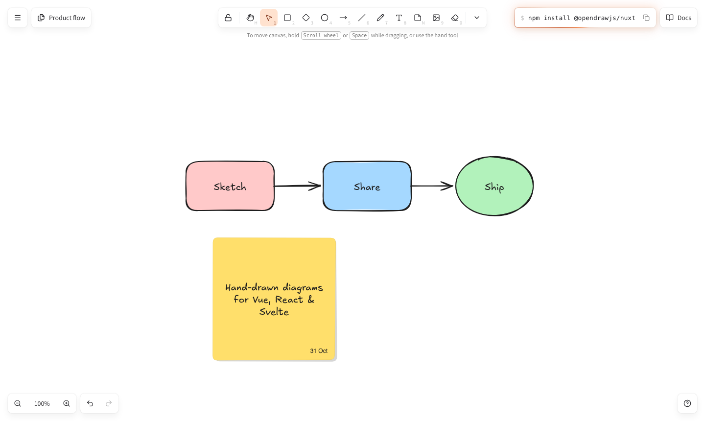

<p align="center">
  <picture>
    <source media="(prefers-color-scheme: dark)" srcset="docs/assets/logo-dark.svg">
    
  </picture>
</p>

<p align="center">
  <strong>Hand-drawn diagrams for Vue, Nuxt, React &amp; Svelte.</strong><br>
  An Excalidraw-style whiteboard as one component — the tools, shortcuts and feel you already know.
</p>

<p align="center">
  <a href="LICENSE"></a>
  
  
  
</p>

<p align="center">
  <a href="#quick-start">Quick start</a> ·
  <a href="#usage">Usage</a> ·
  <a href="#react--svelte">React &amp; Svelte</a> ·
  <a href="#packages">Packages</a> ·
  <a href="#build-your-own-adapter">Adapters</a> ·
  <a href="#development">Development</a>
</p>

<p align="center">
  <picture>
    <source media="(prefers-color-scheme: dark)" srcset="docs/assets/screenshot-dark.png">
    
  </picture>
</p>

---

## Why opendraw

Excalidraw set the bar for how a whiteboard should feel. opendraw brings that feel to Vue, Nuxt, React and Svelte as a native component — no iframe, no foreign runtime — with Excalidraw's behavior as its contract: the same element model, selection and binding semantics, history granularity and keyboard map.

- **Drop-in** — `<OpenDraw />` is the whole editor: canvas, toolbar, properties panel, menus, help and autosave.
- **Familiar** — Excalidraw's tools and shortcuts, its rough.js look and its layout, so users already know it.
- **Headless when you need it** — render only the canvas and build your own chrome on the same reactive API.
- **Framework-free core** — the engine and the interactive editor run without any UI framework; the Vue, React and Svelte packages are thin adapters over it.

## Features

| | |
| --- | --- |
| **Tools** | Selection, hand, rectangle, diamond, ellipse, arrow, line, freedraw, text, sticky note, image, eraser, frame and laser pointer — with Excalidraw's letter and number keys and the tool lock (<kbd>Q</kbd>). |
| **Arrows that connect** | Lines and arrows bind to shapes and follow them, with midpoint snapping, inside/outside binding and curved or sharp routes. |
| **Text everywhere** | Free text and labels inside shapes, edited in place; sticky notes fit their text by shrinking the font before growing. |
| **Frames** | Group content into frames that carry and clip their children; drop elements in or out. |
| **Editing** | Groups, align &amp; distribute, flip, layers, copy/paste styles, Alt-drag duplicate, lock, a context menu and gesture-level undo/redo. |
| **Styling** | Excalidraw's color picker with shades, hex input and eyedropper; fill, stroke, sloppiness, edges, arrowheads, fonts and opacity. |
| **Themes** | Light and dark; dark mode inverts element ink while your canvas background stays exactly as chosen. |
| **Files** | Autosave to `localStorage`, open/save `.opendraw` files, export PNG and SVG. |
| **Responsive** | Desktop layout like excalidraw.com; on phones the toolbar moves to the bottom and the properties panel becomes a sheet. |
| **Accessible** | Real buttons and menus, labelled controls, keyboard navigation in every popover, reduced-motion support. |

## Quick start

```bash
npm install @opendraw/nuxt
```

```ts
// nuxt.config.ts
export default defineNuxtConfig({
  modules: ['@opendraw/nuxt'],
})
```

```vue
<!-- pages/index.vue -->
<template>
  <div style="height: 100vh">
    <OpenDraw />
  </div>
</template>
```

That's it — the editor fills its container and saves to `localStorage` as you draw. Press <kbd>?</kbd> for every shortcut.

**Requirements:** Nuxt 4 · Vue 3.5 · Node 20.19+

## Usage

### `<OpenDraw>`

| Prop | Type | Default | |
| --- | --- | --- | --- |
| `theme` | `'light' \| 'dark' \| 'system'` | `'system'` | Starting theme; a persisted theme wins over it. |
| `ui` | `'full' \| 'minimal' \| 'none'` | `'full'` | `full`: every island · `minimal`: toolbar and zoom · `none`: bare canvas. |
| `grid` | `boolean \| number` | `false` | Show the grid; a number sets the cell size. |
| `initialElements` | `OpenDrawElement[]` | `[]` | Scene to open with when nothing is persisted. |
| `persist` | `boolean \| string` | `true` | Autosave; a string is the storage key, `false` turns it off. |
| `menuLinks` | `{ label, href, icon? }[]` | `[]` | Your links in the main menu. |

| Event | Payload | |
| --- | --- | --- |
| `@change` | `{ elements, appState }` | Every document or editor-state change. |
| `@select` | `string[]` | The selected element ids. |

| Slot | Placement |
| --- | --- |
| `#top-right` | Beside the toolbar — a Share or Docs button. |
| `#footer` | Bottom-right, next to the help button. |

```vue
<script setup lang="ts">
import type { OpenDrawElement } from '@opendraw/core'

function save({ elements }: { elements: readonly OpenDrawElement[] }) {
  // persist the scene anywhere you like
}
</script>

<template>
  <OpenDraw theme="dark" persist="team-board" @change="save">
    <template #top-right>
      <button>Share</button>
    </template>
  </OpenDraw>
</template>
```

### `useOpenDraw()`

Any component inside `<OpenDraw>` can read and drive the editor. State comes back as computed refs; every command is undoable.

```ts
const { selectedElements, changeStyle, exportPNG } = useOpenDraw()

changeStyle({ strokeColor: '#e03131' })
exportPNG('diagram')
```

| Group | Members |
| --- | --- |
| State | `elements`, `selectedElements`, `appState`, `activeTool`, `theme`, `viewport`, `canUndo`, `canRedo` |
| Tools &amp; theme | `setActiveTool`, `toggleToolLock`, `setTheme`, `toggleTheme`, `setGridSize`, `setViewBackgroundColor` |
| Elements | `updateElement`, `deleteSelection`, `duplicateSelection`, `copySelection`, `cutSelection`, `paste` |
| Style &amp; arrange | `changeStyle`, `changeTextStyle`, `groupSelection`, `alignSelection`, `distributeSelection`, `flipSelection`, `reorderSelection` |
| History &amp; view | `undo`, `redo`, `zoomIn`, `zoomOut`, `resetZoom`, `zoomToFitAll`, `panBy` |
| Files | `serialize`, `loadFile`, `saveToFile`, `openFile`, `exportPNG`, `exportSVG`, `clearCanvas` |

### Custom UI

Render just the canvas and bring your own toolbar:

```vue
<script setup lang="ts">
const ctx = createOpenDrawContext()
provideOpenDraw(ctx)
</script>

<template>
  <div class="board">
    <OpenDrawCanvas />
    <nav class="my-toolbar">
      <button @click="ctx.setActiveTool('rectangle')">Rectangle</button>
      <button :disabled="!ctx.canUndo.value" @click="ctx.undo()">Undo</button>
    </nav>
  </div>
</template>
```

The canvas keeps every gesture, shortcut and the text editor — you only draw the buttons.

## React & Svelte

The same editor ships as React and Svelte 5 components: a ready-made `<OpenDraw>` (canvas, toolbar, zoom, history, theme and autosave) and a bare `<OpenDrawCanvas>` for your own UI. Both are covered by one shared end-to-end suite.

```bash
npm install @opendraw/react    # or: npm install @opendraw/svelte
```

```tsx
// React
import '@opendraw/editor/styles.css'
import { OpenDraw } from '@opendraw/react'

export function Board() {
  return (
    <div style={{ height: '100vh' }}>
      <OpenDraw onChange={(state) => console.log(state.elements.length)} />
    </div>
  )
}
```

```svelte
<!-- Svelte 5 -->
<script lang="ts">
  import '@opendraw/editor/styles.css'
  import { OpenDraw } from '@opendraw/svelte'
</script>

<div style="height: 100vh">
  <OpenDraw onchange={(state) => console.log(state.elements.length)} />
</div>
```

| | React | Svelte |
| --- | --- | --- |
| Full editor | `<OpenDraw theme persist initialElements ui onChange>` | `<OpenDraw theme persist initialElements ui onchange>` |
| Canvas only | `<OpenDrawCanvas editor>` | `<OpenDrawCanvas {editor}>` |
| Your own controller | `useOpenDrawEditor()` | `createEditor()` |
| Reactive state | `useEditorState(editor, (e) => e.activeTool)` | `editorState(editor, (e) => e.activeTool).current` |

## Packages

| Package | |
| --- | --- |
| [`@opendraw/nuxt`](packages/nuxt) | The Vue/Nuxt adapter: `<OpenDraw>`, `<OpenDrawCanvas>`, `useOpenDraw()` and the full Excalidraw-style UI. |
| [`@opendraw/react`](packages/react) | The React adapter: `<OpenDraw>`, `<OpenDrawCanvas>`, `useOpenDrawEditor()`, `useEditorState()`. |
| [`@opendraw/svelte`](packages/svelte) | The Svelte 5 adapter: `<OpenDraw>`, `<OpenDrawCanvas>`, `editorState()`. |
| [`@opendraw/editor`](packages/editor) | The framework-free editor: `createEditor()`, `mountCanvas()`, tools, the action registry, persistence, and the shared `styles.css`. |
| [`@opendraw/core`](packages/core) | The engine: element model, document &amp; history, geometry, hit testing, rough.js rendering, PNG/SVG/JSON export. |

```ts
import { OpenDrawDocument, newRectangleElement, exportToSvg } from '@opendraw/core'

const doc = new OpenDrawDocument()
doc.addElement(newRectangleElement({ x: 0, y: 0, width: 160, height: 90 }))
const svg = exportToSvg(doc.getElements(), '#ffffff')
```

## Build your own adapter

Vue, React and Svelte are thin layers over `@opendraw/editor`, and the same layer can be written for Solid, Angular, Lit or plain JavaScript — `packages/react` and `packages/svelte` are complete references in a few hundred lines each:

```ts
import { createEditor, mountCanvas } from '@opendraw/editor'

const editor = createEditor()
const session = mountCanvas(editor, { host, staticCanvas, overlayCanvas })

editor.subscribe((ed) => render(ed.activeTool, ed.selectedElements, ed.canUndo))
// session.dispose() when the host goes away
```

1. **Render the surface** — a focusable host holding two stacked canvases.
2. **Mount and dispose** — `mountCanvas()` wires every gesture, shortcut, the text editor and rendering.
3. **Mirror state** — subscribe and re-render your UI from the controller's getters; build toolbars from `TOOLS` and menus from `ACTIONS`.

The full guide, with plain-JS and React examples, is in the docs (`/docs` in the demo app).

## Keyboard shortcuts

| | | | |
| --- | --- | --- | --- |
| <kbd>V</kbd> / <kbd>1</kbd> Select | <kbd>R</kbd> / <kbd>2</kbd> Rectangle | <kbd>D</kbd> / <kbd>3</kbd> Diamond | <kbd>O</kbd> / <kbd>4</kbd> Ellipse |
| <kbd>A</kbd> / <kbd>5</kbd> Arrow | <kbd>L</kbd> / <kbd>6</kbd> Line | <kbd>P</kbd> / <kbd>7</kbd> Draw | <kbd>T</kbd> / <kbd>8</kbd> Text |
| <kbd>N</kbd> Sticky note | <kbd>9</kbd> Image | <kbd>E</kbd> / <kbd>0</kbd> Eraser | <kbd>F</kbd> Frame · <kbd>K</kbd> Laser |
| <kbd>⌘</kbd><kbd>Z</kbd> Undo | <kbd>⌘</kbd><kbd>G</kbd> Group | <kbd>⌘</kbd><kbd>D</kbd> Duplicate | <kbd>?</kbd> All shortcuts |

## Development

opendraw is a pnpm monorepo.

```bash
pnpm install
pnpm dev          # the demo app (playground/) at http://localhost:3000
pnpm test         # unit tests for core, editor and nuxt
pnpm typecheck    # every package, the playground and the e2e specs
pnpm e2e          # Playwright: the Nuxt demo, then React + Svelte
pnpm e2e:adapters # Playwright: the React and Svelte test apps only
pnpm build        # build the publishable packages
```

```
packages/
  core/     @opendraw/core    engine — no framework, no DOM requirement
  editor/   @opendraw/editor  interactive editor — no UI framework
  nuxt/     @opendraw/nuxt    Vue/Nuxt adapter and UI
  react/    @opendraw/react   React adapter
  svelte/   @opendraw/svelte  Svelte 5 adapter
playground/                   Nuxt demo app, docs page and its e2e specs
test/
  react/    React test app (Vite)
  svelte/   Svelte test app (Vite)
  e2e/      one Playwright suite run against both apps
```

Contributions are welcome. Behavior follows Excalidraw: when something is ambiguous, match what Excalidraw does. Please run `pnpm test`, `pnpm typecheck` and `pnpm e2e` before opening a pull request.

## Acknowledgements

opendraw is an independent implementation — not a fork, and not affiliated with the Excalidraw team. It stands on:

- [Excalidraw](https://github.com/excalidraw/excalidraw) — the behavioral blueprint and the style previews in the properties panel (MIT)
- [rough.js](https://github.com/rough-stuff/rough) — hand-drawn geometry (MIT)
- [perfect-freehand](https://github.com/steveruizok/perfect-freehand) — pressure-aware strokes (MIT)
- [Lucide](https://lucide.dev) — icons (ISC)
- [Assistant](https://fonts.google.com/specimen/Assistant) — UI typeface (OFL)

## License

[MIT](LICENSE) © 2026 Vishnu
